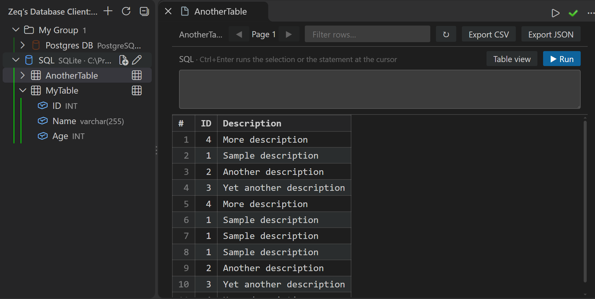

# Zeq's Database Client

Manage PostgreSQL, MySQL/MariaDB and SQLite connections, browse tables and run SQL without leaving VS Code.

## Features

- **Databases:** PostgreSQL, MySQL/MariaDB and SQLite.
- **Unlimited connections:** organise them in groups, give them colours, drag to rearrange. Configs live in global state; passwords are kept in VS Code SecretStorage.
- **SSL / TLS:** for PostgreSQL and MySQL, choose Disable, Require, Verify CA or Verify full per connection, with optional CA, client certificate and client key files (key passphrase kept in SecretStorage). `sslmode` in an imported URL is honoured. Verify full is recommended; Require encrypts without checking the server certificate.
- **Explorer:** Activity Bar → Zeq's Database Client → connection → schema/database → table/view → columns.
- **Table data:** click a table for a paged grid with sorting, row filtering, and CSV or JSON export. A SQL bar lets you query that table in place.
- **Queries:** right-click a connection, schema or table → **New Query**. `Ctrl+Enter` runs the selection or the statement at the cursor, `Ctrl+Shift+Enter` runs the whole file. The status bar shows which connection an editor uses, and the run state: spinner, row count and time, or the error.
- **Generate SQL:** right-click a table or view → **Generate SQL…** for `SELECT`, `INSERT`, `UPDATE` or `DELETE` templates with the real column names.
- **DDL:** **View DDL**, **Copy DDL** and **Export DDL…** for a table, schema or whole connection.
- **ER diagram:** **Show ER Diagram** on a connection, schema or table, with SVG export.

SQLite uses sql.js (wasm): the file is loaded in memory and rewritten after any statement that may modify it.

## Settings

| Setting | Default | Description |
| --- | --- | --- |
| `dbclient.pageSize` | `100` | Rows per page in the table data viewer. |
| `dbclient.maxRows` | `10000` | Maximum rows displayed for a query result. |
| `dbclient.update.source` | | Folder or `.vsix` used by **Check for Updates** and **Reinstall Extension**. |
| `dbclient.update.checkOnStartup` | `false` | Check the update source when VS Code starts. |
``
